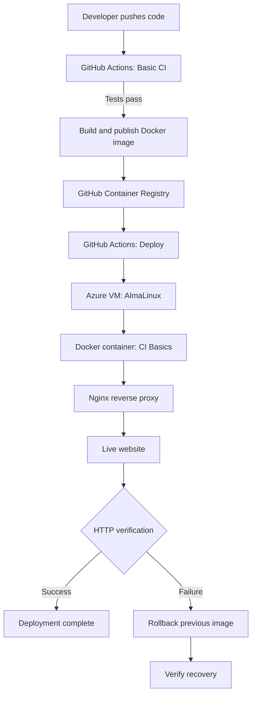

# CI Basics — Automated Deployment to Azure

A hands-on DevOps project demonstrating CI/CD automation using GitHub Actions, Docker, GitHub Container Registry (GHCR), and an Azure VM.

The project automates testing, container image publishing, deployment, post-deployment verification, and rollback when verification fails.

## Live Demo

- **Portfolio:** https://20.197.29.44/
- **CI Basics website:** https://20.197.29.44/ci-basics/

## Architecture

## Tech Stack

- Git and GitHub
- GitHub Actions
- Docker
- GitHub Container Registry (GHCR)
- Azure Virtual Machine
- AlmaLinux
- Nginx
- Bash
- HTML and CSS

## CI/CD Workflow

1. Code is pushed to GitHub.
2. GitHub Actions validates the HTML and runs content tests.
3. A Docker image is built.
4. The image is published to GHCR.
5. GitHub Actions connects to the Azure VM over SSH using a pinned host key.
6. The new image is deployed as a Docker container.
7. An HTTP request verifies that the deployed website responds.
8. If verification fails, the workflow restores the previous Docker image.
9. A second HTTP check verifies that rollback recovered the website.

## Deployment and Recovery

The deployment workflow captures the image ID of the currently running container before deploying the new image.

After deployment, it checks the website over HTTPS. If the check fails, the workflow attempts to restore the previous image and verifies the website again.

The workflow reports a failed deployment even when rollback succeeds. This distinguishes a failed release from a successful recovery.

## Security Considerations

- Deployment credentials are stored as GitHub Actions secrets.
- The VM is accessed using a dedicated SSH deployment key and the `AZURE_VM_KNOWN_HOSTS` secret for pinned host-key verification.
- GitHub Actions permissions are restricted to the required scope.
- The Docker container is bound to `127.0.0.1`; Nginx serves the public HTTPS endpoint.
- Secrets and private keys are not committed to the repository.

## What I Learned

- Creating CI workflows with GitHub Actions.
- Using feature branches and pull requests.
- Validating HTML and running content tests in CI.
- Building and publishing Docker images to GHCR.
- Deploying containers to an Azure VM through SSH.
- Automating deployment verification with HTTP checks.
- Implementing and testing rollback to a previous Docker image.
- Troubleshooting a deployment across GitHub Actions, Docker, Azure, and Nginx.

## Future Improvements

- Add image signature and provenance verification.
- Add an application-specific health endpoint.
- Add monitoring and alerting.
- Provision Azure infrastructure using Terraform.
- Extend the project toward NetDevOps automation.
